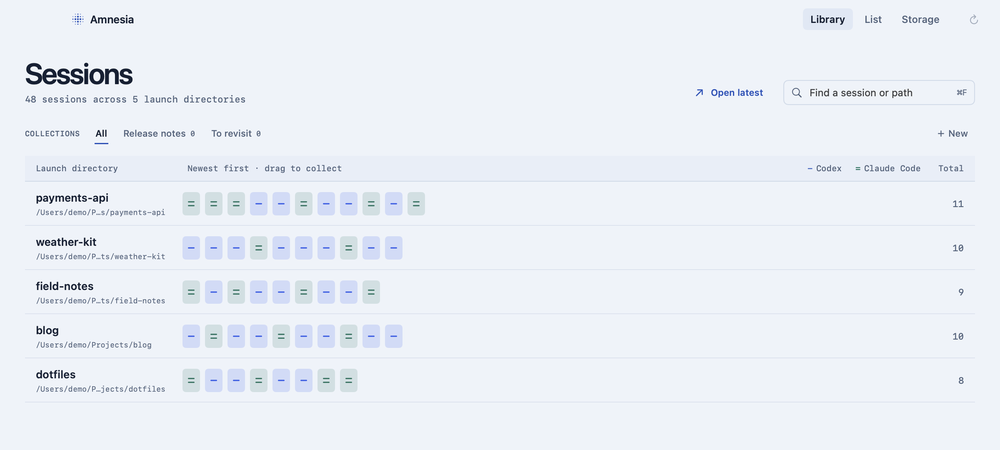
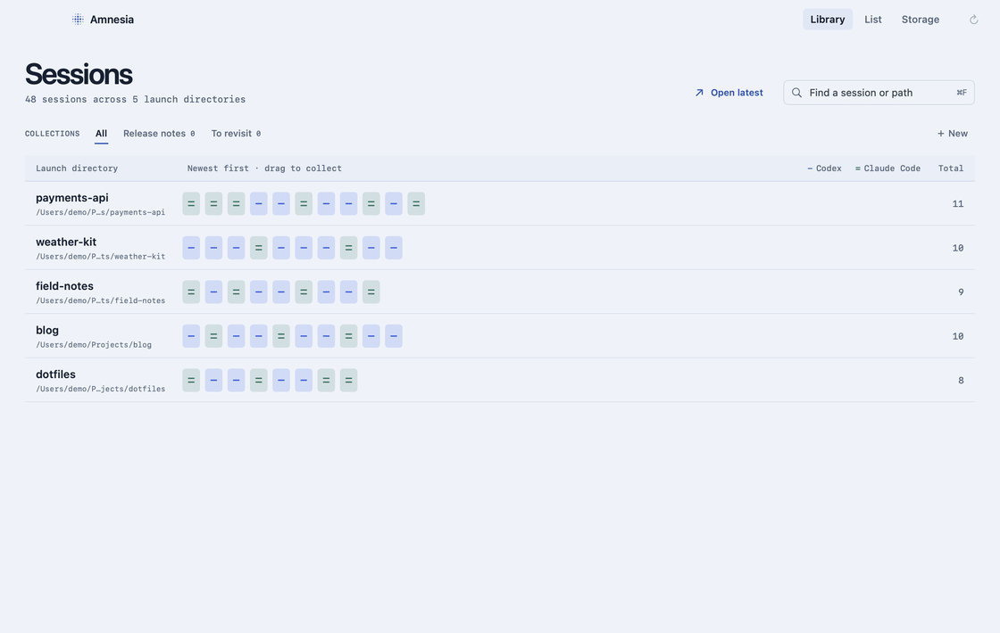

<p align="center">
  
</p>

<h1 align="center">Amnesia</h1>

<p align="center">
  A macOS app to find, organize, and clear local Claude Code and Codex CLI sessions.
</p>

<p align="center">
  
</p>

## Find and organize sessions

**Library** groups conversations by the directory where they started. Each stamp is one session: blue with one line for Codex, green with two for Claude Code. The newest sessions appear first in each row. Hover to see the title and last update, or click to open the reader. Click the directory name to see all its sessions, use **Open latest** to jump back to the most recent one, or press **⌘F** to search by title, last prompt, or path.

Click **+ New** to create a collection, then drag a stamp onto its name. A session can belong to more than one collection; adding or removing it only changes Amnesia’s local collection metadata. The original session files stay where they are. You can also use **List** for a searchable table with source filters and collection controls.

The reader opens in the same window and keeps your place in the library when you go back. It renders Markdown, including code and tables, and can reveal the session file in Finder. For eligible Claude Code sessions, use **Continue in Ghostty** (1.3 or later) to open a tab in the original directory, or copy the resume command to run in another terminal.

<p align="center">
  
</p>

Amnesia reads local sessions from the Claude Code and Codex CLIs. Desktop app conversations aren’t supported.

## See what takes up space

Open **Storage** for a map of the sessions on your Mac. A tile’s area represents its disk usage, and the dots show how recently its sessions were used. Click a project tile to zoom in and see individual sessions. Choose **Browse sessions** to open the corresponding directory and source in **List**.

Delete a session from its storage detail, or use the menu bar to select sessions by project or age. Deletion asks for confirmation. Coding agents can leave prompt history, file snapshots, and logs behind when a transcript is removed by hand; the details below explain what Amnesia cleans up.

## What deleting does

| | Claude Code | Codex |
|---|---|---|
| Transcript | Moved to the Trash | Copy moved to the Trash |
| Other records | Removed for good | Removed for good by `codex delete` |
| Typed prompts in `history.jsonl` | Removed for good | Removed for good |
| Project memory | Never touched | Not applicable |

Transcripts stay on your Mac until you empty the Trash. Running and recently modified sessions are protected, and each session is checked again just before it’s deleted.

## Leftovers

Sessions removed by hand or by the agent's own cleanup often leave records behind, including the prompts you typed. Amnesia lists these under **Leftovers** and can remove them for good.

Anything touched in the last hour, and any running session, is left alone, and everything is scanned again just before cleaning. Project memory is never touched.

## Install

1. Download the zip from the [latest release](https://github.com/ieuforu/Amnesia/releases/latest) and unzip it.
2. Move `Amnesia.app` to your Applications folder.
3. Open it. macOS blocks it the first time, because the app isn't notarized. Click **Done**, not **Move to Trash**.
4. Go to **System Settings → Privacy & Security**, scroll down to **Security** and click **Open Anyway**.

Or skip steps 3 and 4 with this command:

```bash
xattr -d com.apple.quarantine /Applications/Amnesia.app
```

Amnesia opens its session library and stays available in the menu bar. The Dock icon disappears when the library window closes. To start with just the menu bar item, pass `--menu-bar-only`. Requires macOS 14 or later, and the Codex CLI for deleting Codex sessions.

## Build from source

Requires Xcode 16 or later.

```bash
scripts/build-app.sh
open .build/Amnesia.app
```

Run the tests with `swift test`.

For UI development, run `python3 scripts/dev-app.py --demo`. It opens one preview window and watches the Swift sources and resources. After a successful build, the preview restarts without taking focus; after a failed build, the last working preview stays open. Press Ctrl-C to stop the watcher. Omit `--demo` to use your own sessions; the preview keeps its collections separate from the release app.

To try it without touching real data, or to take screenshots, open it with made-up sessions:

```bash
open -n .build/Amnesia.app --args --demo
```

Nothing is read or deleted in demo mode.

## License

[MIT](LICENSE)

Amnesia is an independent project and is not affiliated with Anthropic or OpenAI.
