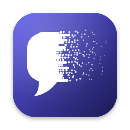
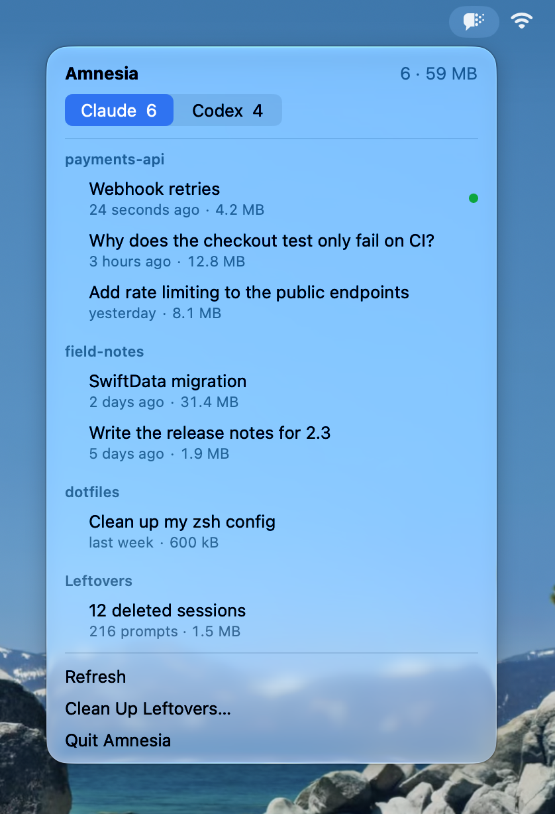
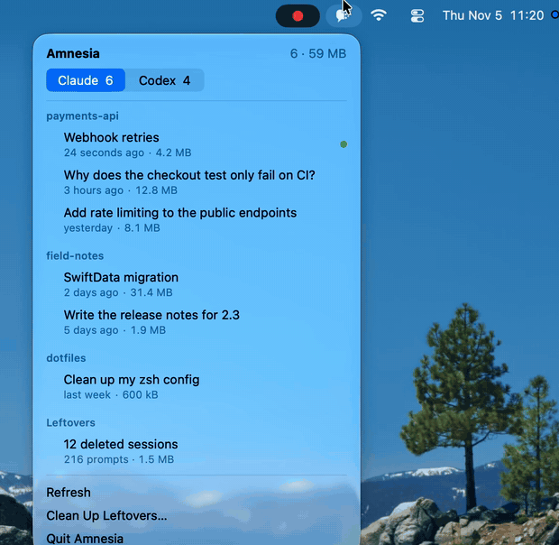

<p align="center">
  
</p>

<h1 align="center">Amnesia</h1>

<p align="center">
  Give your AI amnesia. A macOS app to find, organize, and clear local Claude Code and Codex sessions.
</p>

<p align="center">
  
</p>

## Why

Coding agents keep every conversation on disk: transcripts, prompt history, file snapshots and logs. Deleting one transcript by hand usually leaves the rest behind, including the text you typed. Amnesia aims to show what is stored and remove it properly.

## Features

- Lists Claude Code CLI and Codex CLI sessions, grouped by project
- Shows each session's name or first message, time and size
- Deletes one session in place, or many at once by project or age, and protects any that are in use
- Finds and cleans up records of sessions that no longer exist
- Shows a visual session library organized by launch directory, with one mark per visible conversation
- Lets you drag sessions into local collections and read transcripts with Markdown formatting
- Opens a storage map: area shows size, and tiles dissolve as they go unused
- Opens eligible Claude Code sessions in Ghostty 1.3 or later, or copies the resume command
- Reveals any session's file in Finder

Desktop apps aren't supported yet.

<p align="center">
  
</p>

## What deleting does

| | Claude Code | Codex |
|---|---|---|
| Transcript | Moved to the Trash | Copy moved to the Trash |
| Other records | Removed for good | Removed for good by `codex delete` |
| Typed prompts in `history.jsonl` | Removed for good | Removed for good |
| Project memory | Never touched | Not applicable |

Transcripts stay on your Mac until you empty the Trash. Sessions that are running can't be selected, and each one is checked again just before it's deleted.

## Leftovers

Sessions removed by hand or by the agent's own cleanup often leave records behind, including the prompts you typed. Amnesia lists these under **Leftovers** and can remove them for good.

Anything touched in the last hour, and any running session, is left alone, and everything is scanned again just before cleaning. Project memory is never touched.

## Install

1. Download the zip from the [latest release](https://github.com/ieuforu/Amnesia/releases/latest) and unzip it.
2. Move `Amnesia.app` to your Applications folder.
3. Open it. macOS blocks it the first time, because the app isn't notarized. Click **Done**, not **Move to Trash**.
4. Go to **System Settings → Privacy & Security**, scroll down to **Security** and click **Open Anyway**.

Or skip steps 3 and 4 with this command:

```bash
xattr -d com.apple.quarantine /Applications/Amnesia.app
```

Amnesia opens its session library and stays available in the menu bar. The Dock icon disappears when the library window closes. To start with just the menu bar item, pass `--menu-bar-only`. Requires macOS 14 or later, and the Codex CLI for deleting Codex sessions.

## Build from source

Requires Xcode 16 or later.

```bash
scripts/build-app.sh
open .build/Amnesia.app
```

Run the tests with `swift test`.

For UI development, run `python3 scripts/dev-app.py --demo`. It opens one preview window and watches the Swift sources and resources. After a successful build, the preview restarts without taking focus; after a failed build, the last working preview stays open. Press Ctrl-C to stop the watcher. Omit `--demo` to use your own sessions; the preview keeps its collections separate from the release app.

To try it without touching real data, or to take screenshots, open it with made-up sessions:

```bash
open -n .build/Amnesia.app --args --demo
```

Nothing is read or deleted in demo mode.

## License

[MIT](LICENSE)

Amnesia is an independent project and is not affiliated with Anthropic or OpenAI.
